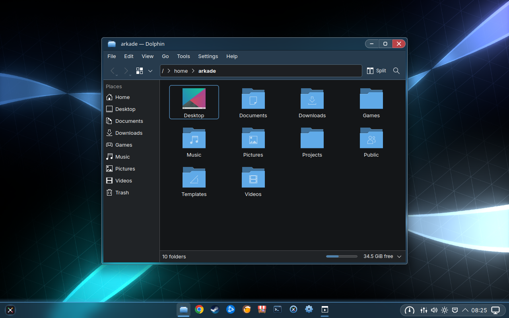
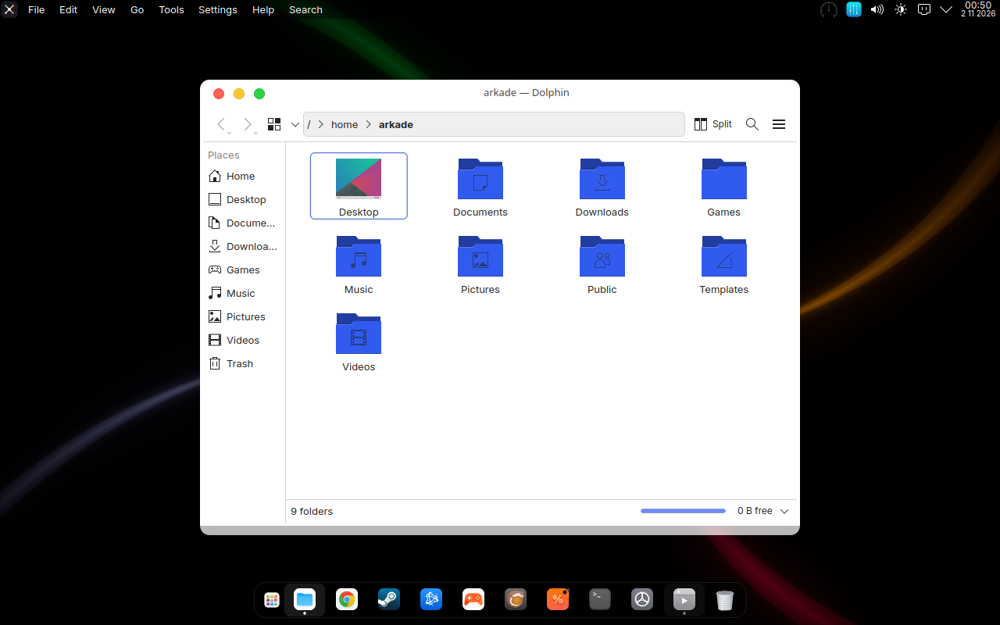
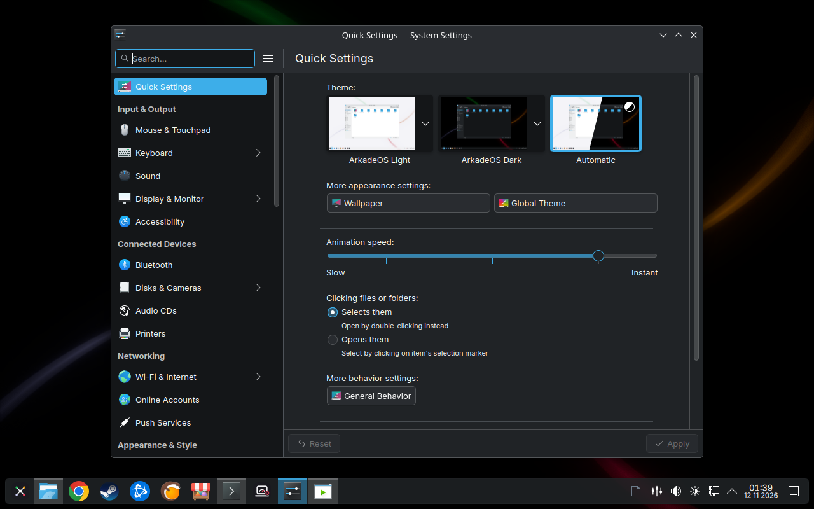
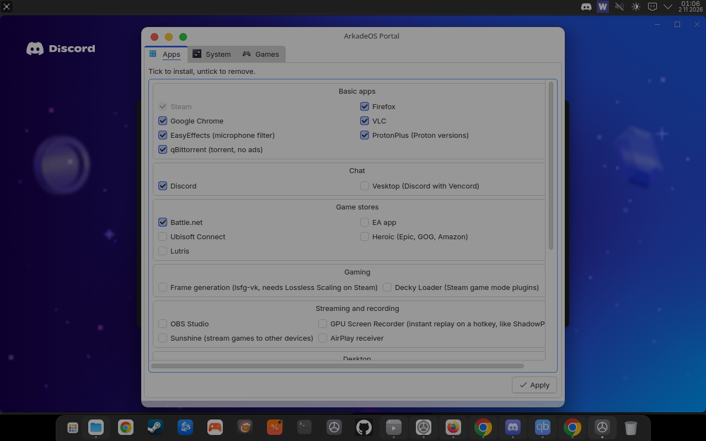
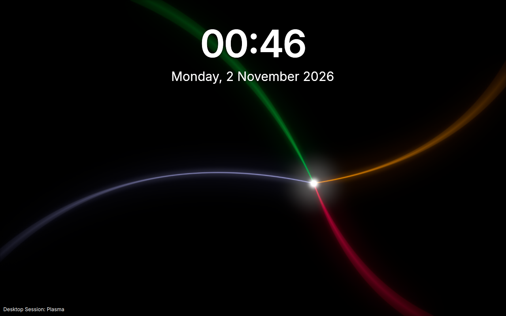

# ArkadeOS

**Fast, gaming-first Linux built on Fedora Atomic.**
A clean KDE Plasma desktop, one image for NVIDIA, AMD and Intel graphics, Steam and Proton, Battle.net, smart power profiles, and atomic updates you can roll back.

> **Status: early development, testing builds only (November 2026).** Not ready for daily use yet. "In testing" means the feature is in the image and checked automatically in a virtual machine on every build; "tested on hardware" means it was also tried on a real gaming laptop. See [Project status](#project-status).



---

## Why ArkadeOS

- **Built for games only.** No background indexing, no services you don't need. The kernel, scheduler and power settings are tuned for low latency and high frame rates.
- **KDE Plasma as KDE made it.** The Breeze look, light and dark, one taskbar at the bottom, menus in the windows, quick search on Meta+Space, window snapping, Alt+Tab previews, clipboard history.
- **Can't be broken by an update.** The whole system is one image. A bad update? Reboot and pick the previous one.
- **One image for every gaming graphics card.** NVIDIA, AMD and Intel: the NVIDIA driver is built in and only runs where an NVIDIA card is. See [Supported graphics cards](#supported-graphics-cards).

## Features

| | Feature | Status |
|---|---|---|
| 🎮 | Steam, Proton-GE, Proton Experimental, Gamescope, MangoHud (set up in MangoJuice), GameMode, Protontricks | in testing |
| ⚔️ | One-click Battle.net with World of Warcraft, WowUp for addons | **tested on hardware** |
| 🛒 | EA app, Ubisoft Connect, Heroic (Epic, GOG, Amazon), Lutris | in testing |
| 🪟 | Borderless windowed games run full screen, above the taskbar | in testing |
| 🎞️ | Frame generation (lsfg-vk) per game, instant replay (GPU Screen Recorder), OBS | in testing |
| 💬 | Discord preinstalled, Vesktop optional for Wayland screen sharing with audio | in testing |
| 🧲 | qBittorrent: free, open-source torrent client without ads (ticked by default, can be left out) | in testing |
| 🎙️ | Microphone noise filter and low-latency audio | in testing |
| ⚡ | Gaming kernel, sched_ext scheduler, NTSYNC | in testing |
| 🔋 | Power profiles: Battery, Balanced, Gaming, Max, WoW, switching automatically, per game | **tested on hardware** |
| 💻 | ASUS gaming laptops (asusctl): the power profile also sets the firmware mode | **tested on hardware** |
| 💻 | MSI (msi-ec, MControlCenter), Lenovo Legion (LenovoLegionLinux); battery care at 80% | in testing |
| 🌈 | RGB that follows the power profile (OpenRGB, ASUS Aura) | **tested on hardware** |
| 🖱️ | Logitech and Razer mice, ASUS ROG keyboards, monitor control, LACT for the graphics card | in testing |
| 🖥️ | KDE Plasma 6 with Breeze, light and dark switching by the time of day, one taskbar | in testing |
| 📌 | Anything pinned on the taskbar stays there: Steam games, Windows programs, Chrome web apps | in testing |
| 🧩 | ArkadeOS Portal: pick apps at first login, add or remove anything later | in testing |
| 🤖 | Optional AI pack: local models (Ollama, Open WebUI) sized to your GPU, AI command-line tools | in testing |
| 🔄 | Atomic image updates with rollback, builds of the last 90 days, factory reset that keeps your files | in testing |
| 📦 | Small updates: the image is split into about 100 layers, so an update downloads only what changed | in testing |
| 💿 | Installer next to Windows, with Windows in the boot menu; shows the download's progress and time left | in testing |
| 🔒 | Encrypted disk unlocked by the TPM, firewall on, telemetry off, nothing running in the background unless you turn it on | in testing |

## Screenshots

| | |
|---|---|
|  |  |
| Light look, Finder-style file manager | Quick Settings: light, dark or automatic |
|  |  |
| ArkadeOS Portal: tick to install, untick to remove | Login screen |

Taken by the automatic VM test of the 2 November 2026 testing build (1280×800 virtual screen).

## Supported graphics cards

| Maker | Supported |
|---|---|
| NVIDIA | GeForce GTX 16 series, RTX 20 series and newer, also in laptops next to the processor's graphics |
| AMD | Radeon RX 400 / 500 (Polaris) and newer; Ryzen processors with Radeon graphics |
| Intel | Arc graphics cards; Iris Xe (11th gen Core) and newer built-in graphics |

Older cards (NVIDIA GTX 10 series and earlier, AMD Radeon before the RX 400) are not supported: ArkadeOS is made for gaming, and these cards cannot run today's games. The installer checks the card: it stops when an unsupported card is the only one, and notes it when the machine also has supported graphics.

One image, `arkadeos`, serves every supported card. Machines installed from the former `arkadeos-nvidia` image keep following that name, which gets the same builds. [Driver coverage](docs/drivers.md) lists which other chips work out of the box.

## Install

**ISO:** a public download comes with the beta. Today's installer ISOs are test builds. They download the newest system image while installing, so the system you get is always up to date.

**Already on Fedora Atomic, Bazzite or another bootc system?** Switch to ArkadeOS. Until the first stable release only the testing channel exists:

```bash
sudo bootc switch ghcr.io/tenarkhq/arkadeos:testing
```

Reboot to finish. The same image works with NVIDIA, AMD and Intel graphics.

**Roll back to the previous version:**

```bash
arkadeos-update rollback
```

The ArkadeOS Portal does the same from a window, and also switches the channel (stable or testing) and goes back to any build of the last 90 days.

## Power profiles

| Profile | When | What it does |
|---|---|---|
| Battery | Automatically on battery | Power-saving CPU mode, no boost, deep sleep states, discrete GPU off |
| Balanced | Automatically on AC | Balanced CPU mode with boost |
| Gaming | Automatically while a game runs | Performance CPU mode, low-latency scheduler, GPU boost |
| Max | Manually, on AC only | Deep sleep states off, fans and platform profile at maximum |
| WoW | Automatically while World of Warcraft runs, or manually | Gaming for the CPU; on a laptop the graphics card is held back to 80% of its power (TGP; on ASUS also Dynamic Boost off) so the shared power and cooling go to the CPU. While the card itself is the bottleneck it gets more, up to all of it, so a weaker card is not slowed down. Desktops: nothing held back. The lowest share is `percent=` in `/etc/arkadeos/gpu-cap.conf` |

## Project status

*Updated 2 November 2026.*

**Every build is tested automatically.** Each change to `main` builds the image and boots it in a virtual machine that logs in, opens the apps, switches the looks and profiles, starts a Windows program under Proton, updates and rolls back. A separate test installs ArkadeOS from the ISO onto an encrypted disk and boots the installed system. Latest results:

| Test | Checks | Result |
|---|---|---|
| `arkadeos` image in a VM | 159 | ✅ all pass |
| Optional apps from the Portal | 40 | ✅ all pass |
| Update from the previous build | 9 | ✅ all pass |
| Install from the ISO (encryption, TPM unlock, Intel RST, download progress) | 60 | ✅ all pass |

**First tests on real hardware** (1 November 2026, ASUS gaming laptop with an NVIDIA RTX 5070 Laptop GPU):

| What | Result |
|---|---|
| Battle.net installs, World of Warcraft starts and runs | ✅ |
| WowUp finds the WoW folder, installs and updates addons | ✅ |
| Unplugging the charger switches to Battery, starting WoW switches to the WoW profile | ✅ |
| The power profile also sets ASUS's firmware mode (Quiet, Balanced, Performance) | ✅ |
| The keyboard lighting follows the power profile | ✅ |
| Terminal welcome | ✅ |
| Frame generation in WoW | works, but its added latency makes spells feel sluggish in WoW; off by default, can be turned on per game |
| Laptop screen brightness | ❌ not adjustable yet on this laptop, being fixed |

**ArkadeOS compared with Windows on the same laptop** (1–2 November 2026, Windows measured on 30 October):

| | Windows | ArkadeOS | Difference |
|---|---|---|---|
| World of Warcraft, average fps | 48.0 | 55.7 | **+16%** |
| World of Warcraft, 1% low fps | 19.7 | 37.3 | **+90%** (1.9×) |
| WoW Mythic+ boss fight, average fps | 102 | 111 | **+9%** |
| WoW Mythic+ boss fight, 1% low fps | 39 | 57 | **+46%** |
| Memory in use when idle | 10.2 GB | 4.5 GB | **−56%** (5.7 GB less) |

Measured the same way on both systems: the same World of Warcraft folder copied over from Windows, with the same addons and graphics settings (preset 8, 2560×1600, DX11; DXVK on ArkadeOS), standing at the fountain in Silvermoon, three 60-second recordings each (CapFrameX on Windows, MangoHud on ArkadeOS). Memory: five minutes after start, nothing open. Runs, average / 1% low: Windows 52/25, 48/15, 44/19; ArkadeOS 58/38, 57/40, 52/34. Boss fight: the end boss of a Blindingvale +10 Mythic+ dungeon, one fight on each system; a group fight varies more from run to run than standing in a city.

**Next:** more real-hardware checks (external monitors, peripherals, desktop PCs, an AMD Radeon machine), then the first stable build, the public beta and the ISO download.

## Known limitations

- **Games with kernel-level anti-cheat do not run on Linux**: Valorant, League of Legends, Fortnite, most recent Call of Duty titles. No Linux distribution can fix this.
- **Secure Boot with NVIDIA:** you confirm the ArkadeOS signing key once during install. The installer walks you through it.
- **DX12 on NVIDIA** is still slower under Proton than on Windows. Where a game offers DX11, ArkadeOS uses whichever mode is faster.
- **No PC sound on HomePod or Apple TV over AirPlay.** Since Apple's 27 releases these devices refuse AirPlay 1 senders, and Linux (PipeWire) has no AirPlay 2 audio sender yet; speakers that accept only AirPlay 2 do not show up at all. Mirroring an iPhone or Mac screen to ArkadeOS works.
- **x86-64 PCs only.** Steam, Proton and the games are x86 software, so ArkadeOS does not run on Apple Silicon Macs or other ARM machines. x86 emulation in a virtual machine there is far too slow for games.

## Build it yourself

```bash
git clone https://github.com/tenarkhq/ArkadeOS.git
cd ArkadeOS
podman build -t arkadeos -f Containerfile .
```

## Built on

- [Fedora Atomic](https://fedoraproject.org/atomic-desktops/)
- [Bazzite](https://bazzite.gg) and [Universal Blue](https://universal-blue.org)
- [KDE Plasma](https://kde.org/plasma-desktop/)

## License

ArkadeOS's own code is licensed under the [Apache License 2.0](LICENSE). Every bundled component keeps its own license.
The ArkadeOS name and logo are not covered by the license. Forks must use a different name.

ArkadeOS is not affiliated with Apple, Valve, Blizzard, NVIDIA or AMD.
